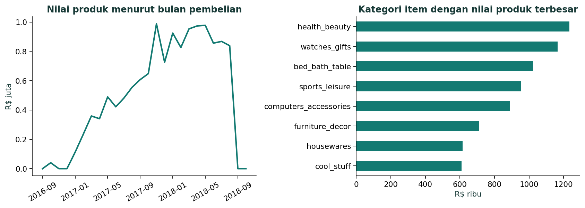
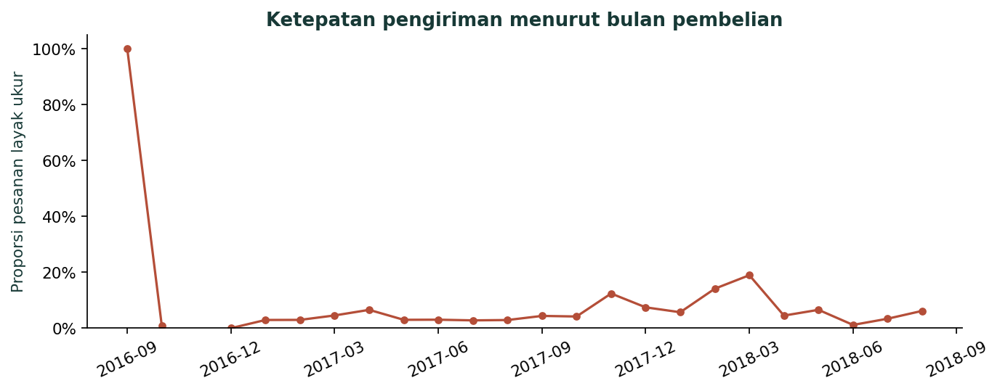

# Olist E-Commerce Sales and Delivery Performance

**Surya Winaldi Yakin · Portofolio Data Analyst**

Studi ini menghubungkan nilai penjualan, ketepatan pengiriman, dan pengalaman pelanggan dari 99.441 pesanan dan 112.650 baris item Olist. Seluruh periode September 2016–Oktober 2018 tersedia. Periode utama Januari 2017–Agustus 2018 dipakai sebagai pembanding dengan laporan sebelumnya.

## Pratinjau analisis

Grafik berikut merupakan hasil notebook. Dashboard Power BI interaktif dapat dijalankan secara lokal melalui `Olist.pbip`. Publikasi web belum tersedia karena izin organisasi.





## Membuka laporan Power BI

1. Ekstrak seluruh folder proyek. Simpan dalam folder pendek di Windows, misalnya `D:\Olist_PowerBI_Portfolio`.
2. Jika lokasinya persis seperti contoh, Power Query sudah menunjuk ke folder `data` yang tepat. Jika berbeda, buka `Olist.SemanticModel/definition/expressions.tmdl` dengan editor teks saat Power BI Desktop tertutup, lalu ubah nilai `FolderData` menjadi path absolut folder `data`, tanpa garis miring di akhir. Jangan pindahkan folder report dan model secara terpisah.
3. Buka `Olist.pbip` dengan Power BI Desktop versi terbaru yang mendukung PBIR, lalu **Refresh** untuk mengimpor CSV. Jika versi Desktop meminta fitur Power BI Project dan PBIR, aktifkan di **Options → Preview features** dan mulai ulang aplikasi.
4. Proyek diarahkan ke halaman Pengiriman saat dibuka. Setiap halaman memiliki slicer cakupan. Pilih **Periode utama** untuk mereproduksi angka lama dan kosongkan pilihan untuk melihat seluruh periode. Slicer periode, wilayah dan kategori berlaku pada halaman tempat slicer tersebut berada. Filter kategori asli pada halaman Penjualan berlaku pada visual kategori item; halaman Pengiriman dan Pengalaman Pelanggan memakai kategori utama pesanan.
5. Cocokkan angka di bawah. Setelah tampilan dan filter diperiksa di Desktop, gunakan **File → Save As** untuk menyimpan `.pbix` jika diperlukan.

| Cakupan | Pesanan | Layak ukur | Terlambat | Nilai produk diterima |
|---|---:|---:|---:|---:|
| Seluruh periode | 99.441 | 96.470 | 6.534 | R$ 13.221.498,11 |
| Periode utama | 99.092 | 96.203 | 6.531 | R$ 13.181.027,13 |

Draf proyek ini berisi tiga halaman, 27 measure, dan 50 kontainer visual termasuk judul, slicer, kartu, grafik, dan tabel. Tema dapat diimpor ulang dari `Olist_Atlas_Theme.json`. Pengguna telah berhasil membuka dashboard di Power BI Desktop dan Power BI Service. Pengujian menyeluruh seluruh kombinasi filter masih belum terdokumentasi. [Dokumentasi PBIR](https://learn.microsoft.com/en-us/power-bi/developer/projects/projects-report).

## Notebook dan laporan

- `notebooks/Analisis_Olist.ipynb` memuat audit, EDA, pembandingan cakupan, analisis segmen dan ambang, statistik durasi, serta rating di dalam negara bagian. Jalankan dari folder proyek atau folder notebooks. Di Colab, unggah kedua CSV ke direktori kerja. Notebook memakai pandas, NumPy, dan Matplotlib.
- `results/` memuat grafik PNG, tabel CSV, dan ringkasan JSON yang dihasilkan notebook.
- `report/` berisi laporan analisis Word/PDF dan [Laporan Pembuatan dan Analisis Dashboard Olist](report/Laporan_Pembuatan_dan_Analisis_Dashboard_Olist.pdf), yang membahas rancangan, temuan visual, dan contoh eksplorasi interaktif.

## Reproduksi data

Dua CSV analitik siap digunakan di folder `data/`. Untuk meregenerasinya, unduh ZIP resmi dari [Olist di Kaggle](https://www.kaggle.com/datasets/olistbr/brazilian-ecommerce). Gunakan Python 3.11 atau lebih baru.

```bash
python src/build.py --zip /path/to/olist.zip --database olist.sqlite --out rebuild_outputs --dashboard rebuild.html
python src/export_data.py --zip /path/to/olist.zip --database olist.sqlite --out rebuild_data
```

Salin dua CSV gabungan dari `rebuild_data/siap_impor/` ke `data/`. Pembayaran diringkas sebelum join dan semua pesanan dipertahankan. Model Power BI mengimpor kolom yang diperlukan untuk analisis. Detail tambahan tetap ada di CSV. Data sumber dan adaptasinya diatribusikan kepada Olist dan menggunakan CC BY-NC-SA 4.0.

## Validasi

Lima sel kode notebook telah dieksekusi di IPython dan menghasilkan empat grafik. Pemeriksaan statis memvalidasi 59 dokumen PBIP/PBIR terhadap skema JSON Microsoft, memastikan semua kolom dan measure yang dirujuk visual tersedia, dan memeriksa posisi kontainer agar tidak bertumpuk. Skema JSON tidak menguji impor data, kalkulasi DAX, maupun hasil rendering di Power BI Desktop.

## Dependensi

```bash
pip install -r requirements.txt
```

## Mengunggah ke GitHub

Ekstrak ZIP, lalu unggah **isi folder proyek** agar README.md berada di akar repository. Sertakan folder Olist.Report dan Olist.SemanticModel secara lengkap. Gunakan Git atau GitHub Desktop untuk kedua CSV yang berukuran besar. Petunjuk ada di [GITHUB_UPLOAD.md](GITHUB_UPLOAD.md).

## Pemeriksaan independen paket

Pada 8 November 2026, notebook dijalankan ulang dan semua angka pada `results/metrics.json` cocok persis. Rekonsiliasi SQL cube dan referensi kolom/measure visual juga lulus. Power BI Desktop dan regenerasi dari ZIP mentah belum diuji ulang dalam sesi ini. Rincian bukti, keterbatasan, dan langkah reproduksi ada di [VALIDATION.md](VALIDATION.md).
